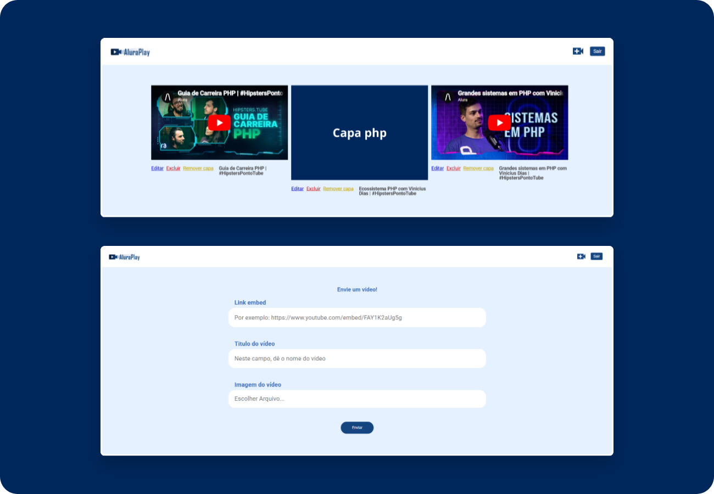

<div align="center">


<h1>Alura Play</h1>

</div>

### Sobre o projeto:


Este projeto faz parte da trilha:

> [PHP Web: crie aplicações web em PHP](https://cursos.alura.com.br/app/learning-guide/alura/php-web)

Cursos envolvidos:

* [PHP na Web: Conhecendo o padrão MVC](https://cursos.alura.com.br/course/php-web-conhecendo-padrao-mvc)
* [PHP na Web: Lidando com segurança e API](https://cursos.alura.com.br/course/php-web-lidando-seguranca-api)
* [PHP na Web: Aplicando boas práticas e PSRs](https://cursos.alura.com.br/course/php-web-aplicando-boas-praticas-psrs)

---

### Funcionalidades:

O AluraPlay é uma aplicação web com PHP puro e com o objetivo de praticar conceitos fundamentais de backend.

A aplicação simula uma plataforma simples de vídeos, permitindo gerenciar conteúdos e usuários, aplicando boas práticas de desenvolvimento.


#### CRUD
* Criar, Ler, Editar, Excluir um vídeo
#### Autenticação
* Login de usuários
* Criação de novos usuários
* Proteção de rotas
#### Upload de Arquivos
* Upload de imagens para os vídeos
* Armazenamento local

---

### Arquitetura:

O projeto segue conceitos de organização inspirados em MVC:

* Models → Manipulação de dados
* Views → Interface (PHP + HTML)
* Controllers → Regras de negócio

---

### Como rodar o projeto:

#### Pré-requisitos
Antes de começar, você precisa ter:

- PHP 8+
- Composer
- SQLite (ou outro banco configurado)
- Servidor local (XAMPP, Laragon, etc.)

#### 1️⃣ Clone o repositório

<pre>
git clone https://github.com/MarianSantos14/AluraPlay.git
cd AluraPlay
</pre>

#### 2️⃣ Instale as dependências

<pre>
composer install
</pre>

#### 3️⃣ Configure o ambiente

<pre>
Crie um arquivo .env
Configure conexão com banco de dados
</pre>

Execute as queries abaixo no seu terminal MySQL ou ferramenta de administração (como PHPMyAdmin / MySQL Workbench):

```sql
-- Criar o banco de dados
CREATE DATABASE aluraplay;
USE aluraplay;

-- Criar a tabela de vídeos
CREATE TABLE videos (
    id INT AUTO_INCREMENT PRIMARY KEY,
    url VARCHAR(255) NOT NULL,
    titulo VARCHAR(255) NOT NULL,
    image_path VARCHAR(255),
    created_at TIMESTAMP DEFAULT CURRENT_TIMESTAMP
);

-- Inserir dados iniciais de teste
INSERT INTO videos (url, titulo, image_path, created_at) VALUES
('[https://www.youtube.com/embed/ETohL_o3SEI?si=UaM7ZeU8AZvq9lfi&amp;start=41](https://www.youtube.com/embed/ETohL_o3SEI?si=UaM7ZeU8AZvq9lfi&amp;start=41)', 'Guia de Carreira PHP | #HipstersPontoTube', NULL, '2026-05-30 14:23:14'),
('[https://www.youtube.com/embed/yD3BqXWHua4?si=QutEQaJurFAIvWtq&amp;start=41](https://www.youtube.com/embed/yD3BqXWHua4?si=QutEQaJurFAIvWtq&amp;start=41)', 'Ecossistema PHP com Vinicius Dias | #HipstersPontoTube', NULL, '2026-05-30 14:26:53'),
('[https://www.youtube.com/embed/arZCoJMSTlI?si=qK-hd55rIEXLjguG&start=41](https://www.youtube.com/embed/arZCoJMSTlI?si=qK-hd55rIEXLjguG&start=41)', 'Grandes sistemas em PHP com Vinicius Dias | #HipstersPontoTube', NULL, '2026-05-30 14:28:00');

-- Criar a tabela de utilizadores
CREATE TABLE users (
    id INT AUTO_INCREMENT PRIMARY KEY,
    email VARCHAR(150) UNIQUE NOT NULL,
    password VARCHAR(255) NOT NULL,
    created_at TIMESTAMP DEFAULT CURRENT_TIMESTAMP
);
```

e digite no terminal

<pre>
criar-usuario.php email@gmail.com 12345678
</pre>

4️⃣ Inicie o servidor

<pre>
php -S localhost:8000 -t public
</pre>

5️⃣ Acesse no navegador

<pre>
http://localhost:8000
</pre>

dados para efetuar o login:

<pre>
E-mail: email@gmail.com
Senha: 12345678
</pre>

---

###  Aprendizados:

* Estruturação de projetos PHP
* Padrão MVC
* CRUD completo
* Autenticação de usuários
* Upload de arquivos
* Organização de código backend

---

<br>

Obs: Projeto com fins educacionais desenvolvido durante cursos da Alura.
